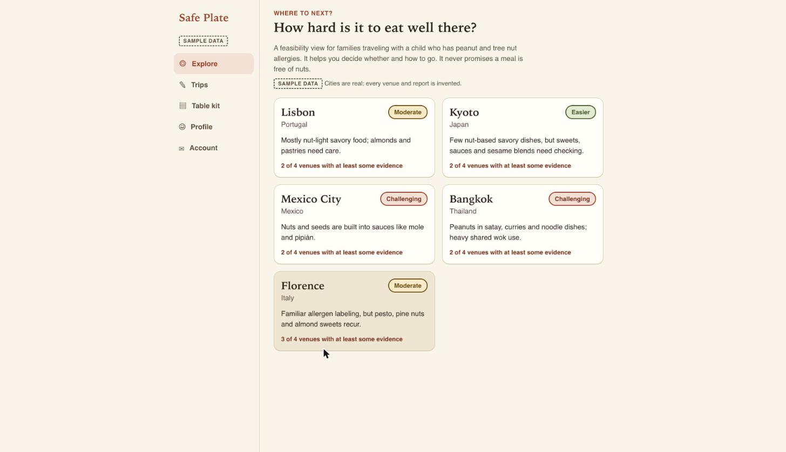
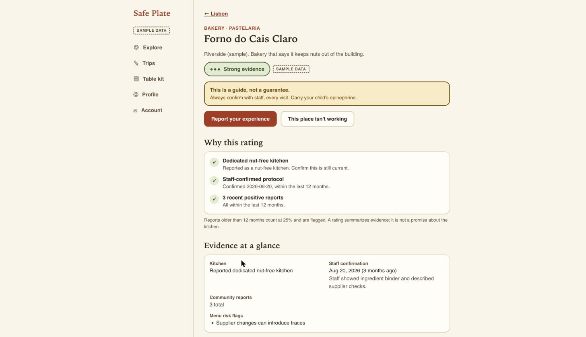

# Safe Plate

A travel-planning web app for parents of a child with severe peanut and tree nut allergies. It helps you judge, before a trip, how workable each destination is, and shows the evidence behind every venue rating. It never gives a "safe" verdict.

> **A guide, not a guarantee.** Always confirm with staff. Carry your child's epinephrine.
> All venues, reports and ratings in this repository are invented sample data.

## Snapshots

**Explore: pre-trip feasibility by destination**

**Venue detail: why a place has the rating it has**

## What it does

- **Destination feasibility:** Easier, Moderate or Challenging, based on cuisine patterns.
- **Evidence-based venue ratings:** Strong, Some, Limited or Conflicting. Each rating explains its reasons.
- **Report recency:** reports older than 12 months are flagged and count for less.
- **Recovery path:** when a place isn't working, see nearby alternatives, a grocery fallback and emergency steps.
- **Trip planner:** pin places to meals and get a warning when a day has no meal with at least some evidence.
- **Table kit:** a high-contrast allergy card in six languages (placeholder translations, to be verified).

## Built with

React, Vite, TypeScript, Tailwind CSS and Supabase (accounts and shared reports).

## Status

Early prototype. Run it locally with `npm install` then `npm run dev`. Copy `.env.example` to `.env.local` and add your own Supabase URL and publishable key to turn on accounts and shared reports.
